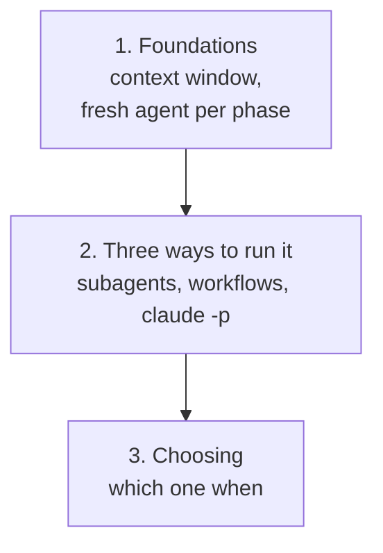

# AI agents

> What this covers: getting real engineering work done with AI coding agents: why an agent's context fills up, how to split a long plan across **fresh agents** that hand off through a file, and the three ways to automate that in Claude Code (subagents, workflow scripts, headless `claude -p`).

## How to use this

Read the sections **top to bottom**: each one assumes the ones above it. Links in *italics* are notes not written yet (the roadmap).



## 1. Foundations
- *[[Context window]]*: what an agent "remembers", why long sessions get worse, what summarizing loses
- [[Multi-agent pipeline]]: run a plan phase by phase with a fresh dev agent (Opus) and a test agent (Sonnet) per phase, the only memory between them being `HANDOFF.md`. The fix loop, and the tips that make it work

## 2. Three ways to run it
- [[Subagents]]: define `dev` and `tester` once as files in `.claude/agents/`, then ask the main session to run the plan. Easy, watchable, but the model drives the loop
- [[Workflow scripts]]: a JavaScript file decides the order of steps, each `agent()` call is a fresh agent, structured verdicts with a schema, resume after a crash
- [[Headless Claude Code]]: `claude -p` in a bash loop, one process per agent, `--allowedTools`, JSON output read with `jq`, a commit per phase, runs from cron

## 3. Choosing
- [[Subagents vs workflows vs headless]]: who controls the loop, live view, resume, unattended runs, and the recommendation

## Related areas
- [[Infrastructure as code]]: the same "your script decides, not a person" idea, applied to infrastructure
- [[Operating systems]]: processes and signals, what `claude -p` and cron actually are

## Weakest first
```dataview
TABLE WITHOUT ID file.link AS Note, type AS Type, confidence AS Conf
FROM ""
WHERE topic = this.file.name AND confidence
SORT confidence ASC
```

## Open questions
- 
