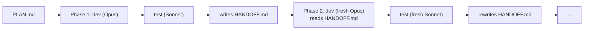
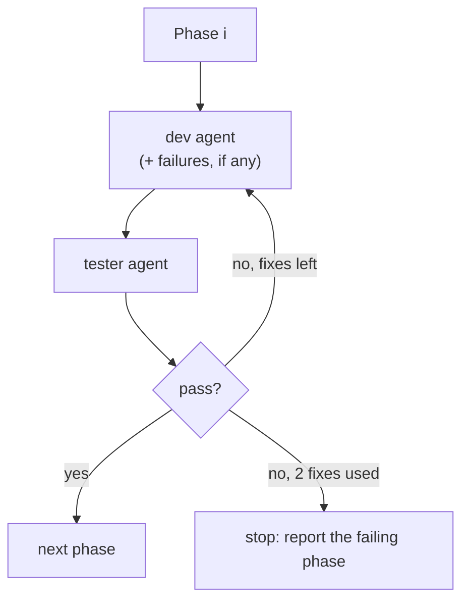

# Multi-agent pipeline

> [!abstract] In one sentence
> Instead of one long session that slowly fills its context, each phase of a plan gets a **brand-new agent** with an empty context: a dev agent (Opus) builds the phase, a test agent (Sonnet) checks it, and a short `HANDOFF.md` file is the **only** thing passed to the next phase, while the orchestrator keeps nothing but one-line results ("phase 2: pass").

## Plan of this note
1. The problem: one session doing a whole plan fills its context
2. Why "just clear it" doesn't work from inside a session
3. The fix: a fresh agent per phase, with a handoff file as the only memory
4. Splitting each phase into dev + test, and the fix loop
5. The three ways to set it up (each has its own note)
6. Tips that make it work

## Build-up: a five-phase plan in one session

I have a `PLAN.md` with five phases (set up the project, add the data model, the API (Application Programming Interface), the CLI (command-line interface), the docs). I open one Claude Code session and say "implement the plan".

### Stage 1: the context fills up

Everything the agent does lands in its **context**: every file it reads, every command output, every diff it writes. By phase 3, the context holds the whole history of phases 1 and 2, most of which no longer matters (old test output, files that were rewritten since). That costs in three ways:
- **Quality**: the model has more irrelevant text to sift through, and details from early on get lost or mixed up
- **Usage**: every new turn re-sends that whole context, so each step costs more than the last
- **Summaries**: when the context gets too long it is compacted into a summary, and the summary drops details nobody chose to drop

### Stage 2: "then clear it between phases"

`/clear` empties the context, but it's a command **only I can type**. From inside a session, nothing can wipe the main agent's context automatically: the agent can't clear itself halfway through a plan. So the clearing would need me sitting there after every phase.

### Stage 3: start fresh instead of clearing

The way round it: don't clear the old agent, **start a new one** for each phase. A new agent starts with an empty context by definition. The catch is that it also knows nothing about what earlier phases did, so the knowledge has to travel some other way: a file.

- `PLAN.md`: the whole plan, written once by me
- `HANDOFF.md`: rewritten at the end of every phase: what exists now, files touched, decisions and why, open issues, what the next phase must know. It's the next agent's **entire memory** of the past

The **orchestrator** (whatever runs the phases: a session, a script) only keeps short results like "phase 2: pass", never the dev work itself. So its context stays small too, without any clearing.

### Stage 4: dev and test as separate agents

Each phase is two agents, each the right model for its job:

| Role | Model | Does | Must not |
|---|---|---|---|
| **dev** | Opus (the strongest, most expensive) | Reads `HANDOFF.md`, implements exactly one phase, rewrites `HANDOFF.md` (under 300 lines) | Do other phases |
| **tester** | Sonnet (cheaper) | Reads `HANDOFF.md`, writes or extends tests for the phase, runs the **whole** suite, reports pass/fail with the exact failures | Change non-test code |

Why separate: a tester that didn't write the code has no stake in it passing, and "never change non-test code" stops it from "fixing" a failure by editing the code under test.

### Stage 5: the fix loop, capped

When tests fail, the failures go **back to a new dev agent** for the same phase, with the tester's report in its prompt. Then a new tester runs again.

The loop is capped (at most **2 fixes** per phase): an agent that can't fix something would otherwise try forever and burn through the usage limits. Stopping the whole run at a phase that still fails also avoids building phase 4 on a broken phase 3.

### Stage 6: three ways to wire it up

The idea is the same; what changes is **who runs the loop**:

| Way | Who drives | Note |
|---|---|---|
| Subagents | The main model, from my instruction | [[Subagents]] |
| Workflow script | My JavaScript code, inside Claude Code | [[Workflow scripts]] |
| `claude -p` bash script | My bash code, no session at all | [[Headless Claude Code]] |

Compared side by side in [[Subagents vs workflows vs headless]].

## Tips that make it work

1. **Write the plan for agents that have no memory.** Each phase in `PLAN.md` should make sense on its own and include an **acceptance criteria** line, so the tester knows what "pass" means
2. **Keep the handoff file short and give it fixed sections** (state, files touched, decisions and why, open issues). It's the only memory the next agent gets, and a 2,000-line handoff brings back the context bloat the whole design is avoiding
3. **Commit after every passing phase.** That gives checkpoints to roll back to if a later phase goes wrong
4. **Watch the usage limits.** Each phase costs at least 2 agent runs, plus retries. Sonnet is cheaper, so it does the testing and the plan parsing, and Opus only the dev work

## Advanced problems

| Symptom | Cause | Fix |
|---|---|---|
| Phase 4 redoes or breaks something phase 2 decided | The decision wasn't in `HANDOFF.md` | Make "decisions and why" a fixed section of the handoff |
| Tester passes everything | Phase had no acceptance criteria, tester tested trivial things | Add an acceptance line per phase in `PLAN.md` |
| Tests pass but code was changed to fit them | Tester edited non-test code | Say "never change non-test code" in its definition, and check the diff |
| Every phase gets slower | The handoff keeps growing | Rewrite (not append to) the handoff, with a line limit |

## Practice

> [!example]- Why can't the main agent just run `/clear` after each phase?
> `/clear` is a command only the user can type. From inside a session nothing can wipe the main agent's context, so the way round it is a new agent per phase.

> [!example]- What does the agent for phase 3 know about phases 1 and 2?
> Only what's in `PLAN.md` and `HANDOFF.md` (and the code on disk). Nothing from the earlier agents' contexts.

> [!example]- Why cap the fix loop at 2?
> A phase the dev agent can't fix would otherwise loop forever and burn the usage limits, and later phases shouldn't be built on a failing one.

## Easy to get wrong
- A fresh agent is **empty**: anything not written to `HANDOFF.md` (or the code) is gone
- The orchestrator must keep only short results, or its own context grows instead
- The tester runs the **whole** suite, not just the new tests: phase 3 can break phase 1
- A long handoff file defeats the purpose

## Related
- Implemented with:: [[Subagents]], [[Workflow scripts]], [[Headless Claude Code]]
- Compared in:: [[Subagents vs workflows vs headless]]
- Depends on:: *[[Context window]]*
- Area:: [[AI agents]]

## Flashcards
#flashcards

Why give each phase of a plan a new agent? :: A new agent starts with an empty context, so old phases don't bloat it (quality, cost, lossy summaries)
Why can't the main agent clear its own context between phases? :: /clear is a command only the user can type
What is the only memory passed between phases? :: The HANDOFF.md file (plus the plan and the code on disk)
What goes in HANDOFF.md? :: Current state, files touched, decisions and why, open issues, what the next phase must know. Under 300 lines
What does the orchestrator keep? :: Only short results like "phase 2: pass", never the dev work
Which model for dev and which for testing? :: Opus for dev, Sonnet (cheaper) for testing and plan parsing
What is the tester never allowed to do? :: Change non-test code
What happens when tests fail? :: The failures go to a fresh dev agent for the same phase, at most 2 times, then the run stops
Why must each plan phase have acceptance criteria? :: So the tester knows what "pass" means, since it has no memory of the intent
Why commit after every passing phase? :: Checkpoints to roll back to if a later phase goes wrong
