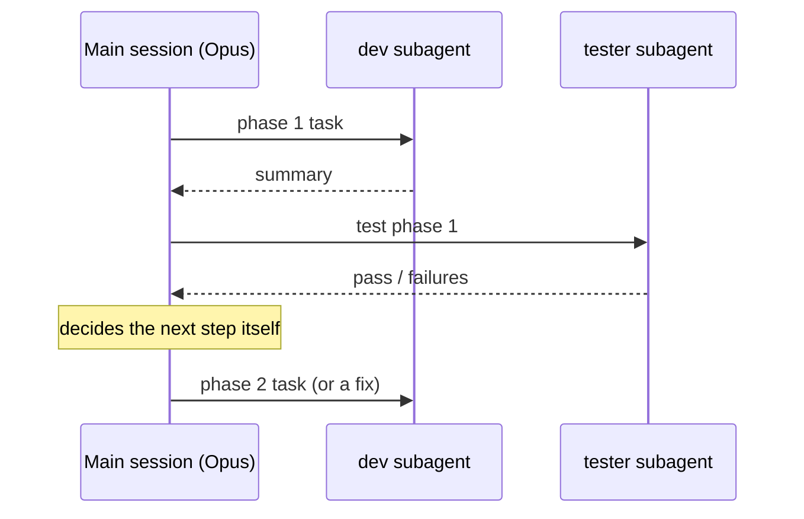

# Subagents

> [!abstract] In one sentence
> A **subagent** is a role (`dev`, `tester`) defined once as a Markdown file in `.claude/agents/`, with its own model and instructions; the main session hands it a task, it runs in a **fresh context**, and only its summary comes back: the easiest way to run a [[Multi-agent pipeline]], but the **model** decides the loop.

## Build-up

### The problem
To run [[Multi-agent pipeline|a plan phase by phase]] with a fresh agent per phase, I need two things: a way to start a new agent from inside my session, and the same instructions for that agent every time (read `HANDOFF.md`, do one phase, rewrite the handoff). Retyping those instructions per phase is error-prone.

### Define the roles once
Each role is a file with frontmatter (name, when to use it, which model) and a body (its standing instructions). The place decides the reach:
- `.claude/agents/` in a project: that project only
- `~/.claude/agents/` in my home folder: all projects

```markdown
<!-- .claude/agents/dev.md -->
---
name: dev
description: Implements one phase of a plan. Use for every implementation phase.
model: opus
---
You implement exactly one phase of the plan you are given.
Start by reading HANDOFF.md if it exists: it is everything earlier phases left you.
When done, rewrite HANDOFF.md: what exists now, files touched, decisions and why,
open issues, what the next phase must know. Under 300 lines.
```

```markdown
<!-- .claude/agents/tester.md -->
---
name: tester
description: Tests the phase just implemented. Use after every dev phase.
model: sonnet
---
Read HANDOFF.md, write or extend tests for the phase just implemented, run the
whole suite, and report pass/fail with the exact failures. Never change non-test code.
```

The `description` matters: it's what the main model reads to decide **when** to use the agent ("use for every implementation phase").

### Drive it from a normal session
In a normal Opus session I ask:

> *"Run PLAN.md phase by phase: the dev agent for each phase, then the tester; if tests fail, send the failures back to dev, at most twice."*

The main agent then starts `dev`, waits for its summary, starts `tester`, reads the verdict, and loops.



### What's good, and the limit
- **Good:** nothing extra to learn, and I can watch each step happen
- **Limit 1:** the main agent **decides the loop itself**, so it can skip steps, improvise ("tests are mostly fine, moving on"), or forget the retry cap. My instruction is a request, not code
- **Limit 2:** each subagent's summary lands in the main context, so the main context still **slowly grows** with every phase. Much slower than doing all the work itself, but not flat

Both limits go away when code drives the loop: [[Workflow scripts]] and [[Headless Claude Code]].

## Easy to get wrong
- A subagent's context is fresh, but the **main** session's isn't: it collects every summary
- The retry cap in my prompt is not enforced by anything
- Project agents (`.claude/agents/`) vs everywhere (`~/.claude/agents/`)
- The `model:` line is per role: Opus for dev, Sonnet for testing

## Related
- Used for:: [[Multi-agent pipeline]]
- Differs from:: [[Workflow scripts]], [[Headless Claude Code]]
- Compared in:: [[Subagents vs workflows vs headless]]
- Area:: [[AI agents]]

## Flashcards
#flashcards

What is a subagent in Claude Code? :: A role defined as a Markdown file with its own model and instructions, run in a fresh context, returning only a summary
Where are subagents defined? :: .claude/agents/ for one project, ~/.claude/agents/ for all projects
What does the description field of a subagent do? :: Tells the main model when to use that agent
How do you run a plan with subagents? :: Ask the main session in plain words to run each phase with dev then tester, with a retry cap
Who controls the loop with subagents? :: The main model, so it can skip steps or improvise
Why does the main context still grow with subagents? :: Every subagent's summary is added to it
