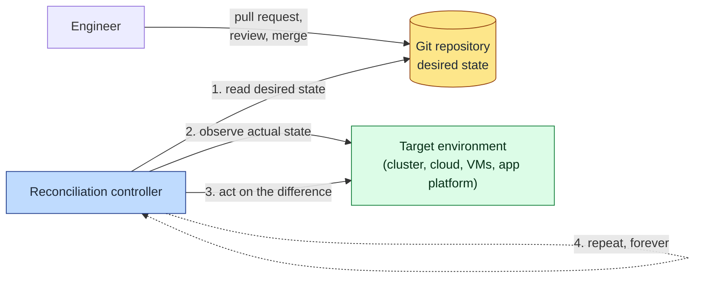
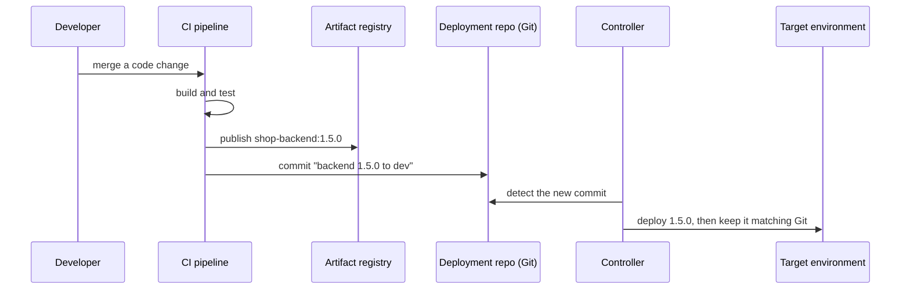

# GitOps basics

> [!abstract] In one sentence
> GitOps is an **operating model, not a Kubernetes feature**: the desired state of infrastructure or applications is **declared in Git**, Git is the **only source of truth**, and automation **keeps comparing** the real system with Git and **reconciling** the difference, whether the target is a Kubernetes cluster, cloud infrastructure, VMs or an application platform.
>
> *Git: the version control system (not an acronym) · VM: virtual machine*

## Plan of this note

Each stage exists because the one before it left a problem:

1. Changes made by hand, in many places → nobody knows what's running
2. Files in Git, applied by a person or a pipeline → reviewed, but applied once, from outside, and reality drifts between runs
3. A controller that keeps reconciling reality to Git → the core idea, its three parts, and the four principles that define it
4. The same model on different targets: Kubernetes, cloud infrastructure, VMs, application deploys (and how GitOps each one really is)
5. How it sits next to CI/CD: CI builds the artifact, GitOps owns the deployment state

Then what isn't GitOps, failure modes, and how AWS does it. The Kubernetes version (Argo CD, Flux, repository layout, self-heal, secrets) has its own note: [[GitOps on Kubernetes]].

## Build-up: one company, three kinds of system

Acme's shop doesn't run in one place:

- **Cloud infrastructure** on AWS (Amazon Web Services): a VPC (Virtual Private Cloud) `10.0.0.0/16`, subnets, a PostgreSQL database on RDS (Relational Database Service)
- **Two VMs**, `report-01` (`10.0.1.20`) and `report-02` (`10.0.1.21`), running an older reporting service: nginx, a Python app, a few config files and a cron job
- **The shop backend** in a Kubernetes cluster

The question of this note is **how a change reaches each of these systems**, and how the team knows what's actually running there.

### Stage 1: changes by hand

Everyone starts here. The database gets a bigger instance class in the AWS console. Someone opens an SSH (Secure Shell) session on `report-01`, edits `/etc/nginx/nginx.conf` and reloads nginx. Someone else runs `kubectl set image` to deploy a new backend version.

It works until the team grows:

- **What is running?** The only honest answer is "go and look". `report-01` and `report-02` were meant to be identical, but only one got the nginx fix
- **Who changed what, and why?** The console has an audit trail, the VMs have shell history (maybe), and none of it links to a ticket or a review
- **Nothing can be rebuilt.** If `report-02` dies, nobody knows every package and file that was on it
- **Everyone needs write access to everything**, in every environment

### Stage 2: files in Git, applied by a pipeline

The fix every team reaches first: **describe the systems in files, keep the files in Git, and apply them through a pipeline** after review. Terraform for the cloud resources ([[Terraform in production]]), an Ansible playbook for the VMs, Kubernetes manifests for the backend. On merge to `main`, a CI/CD (continuous integration and continuous delivery) job runs `terraform apply`, `ansible-playbook` and `kubectl apply`.

A big step: changes are reviewed, and the Git history is the history of changes. But look at what's still missing:

- **Reality is only checked when the pipeline runs.** Someone fixes nginx by hand on `report-01` at 2 a.m. Git now says one thing and the VM says another, and nothing notices until the next run overwrites the fix, or nobody runs anything for a month and the files quietly stop being true
- **The pipeline holds write credentials to every target.** CI runs code from pull requests and third-party plugins: whoever compromises it can change production. And every target has to be reachable from the CI runners
- **A failed run stays failed.** Half the changes were applied, and nobody re-runs it unless someone notices
- **The desired state can hide in scripts.** "Run this, then that, then restart" in a pipeline file isn't a description of the end state, it's a list of steps

> [!warning] Files in Git aren't enough
> Keeping infrastructure files in a repository is good practice, but it doesn't make a system GitOps. What's missing in Stage 2 is that Git is only **consulted** once per merge: the real system can drift away and nothing pulls it back. Git becomes the source of truth only when something keeps enforcing it.

The root problem: the pipeline runs **once per change** and **from outside**. What's needed is something that runs **continuously**, ideally **next to the system**.

### Stage 3: a controller that reconciles

The idea comes from control loops: a thermostat doesn't heat the room once, it keeps measuring and correcting. GitOps puts such a loop between Git and the real system. It has **three parts**:

1. **A Git repository** with the **desired state**: application versions, configuration, infrastructure definitions
2. **A reconciliation (or deployment) controller** that compares Git's desired state with the actual state
3. **The target environment**: VMs, containers, Kubernetes, cloud infrastructure, application configuration

A small example: Git declares **three replicas** of the reporting app. One process crashes and never comes back, so **two** are running. On its next pass, the controller sees the mismatch (3 declared, 2 actual) and starts a third. Nobody filed a ticket; the declared state was enough. The same loop catches the 2 a.m. nginx edit: the file on `report-01` no longer matches Git, so the controller either reports it or writes the Git version back.

What changes compared with Stage 2:

| Problem from Stage 2 | Why a reconciling controller fixes it |
|---|---|
| Reality checked only on merge | Checked **every few minutes, forever**. Drift is seen and, where supported, undone |
| CI holds write credentials | The controller runs **in or near the target** with its own permissions. CI may need none, and Git access is read-only |
| Targets must be reachable from CI | Connections can go **outward**, from the controller to Git |
| Failed runs stay half-applied | The next pass retries. Nothing depends on one run succeeding |
| Desired state hidden in scripts | Git holds the **end state**; the controller works out the steps |
| Rollback | **Revert the Git commit**, and the controller reconciles to the old state |

> [!info] The four principles (OpenGitOps)
> The CNCF (Cloud Native Computing Foundation) working group OpenGitOps defines GitOps by four principles. Each one maps to a stage above:
> 1. **Declarative**: the system is described as a desired end state, not as steps
> 2. **Versioned and immutable**: that state is stored so every version is kept and can't be silently changed (Git history)
> 3. **Pulled automatically**: agents fetch the desired state themselves, instead of a pipeline pushing it
> 4. **Continuously reconciled**: agents keep comparing and correcting, not once per deploy
>
> None of them mentions Kubernetes. Stage 2 has 1 and 2; Stage 3 adds 3 and 4.

### Stage 4: the same model on different targets

The loop needs two things from a target: a way to **declare** its state, and something that can **observe and correct** it repeatedly. Each kind of system gets those from different tools, and some get them only partly.

**Kubernetes.** Tools: **Argo CD**, **Flux CD**. Git stores Kubernetes manifests, Helm charts or Kustomize configurations. A controller in the cluster applies changes and continuously reconciles the cluster's state. This is where GitOps became popular, because Kubernetes already works this way inside: every object is declared, and its own controllers keep reality equal to it. A GitOps agent is just one more controller, whose desired state is a Git folder. Full detail in [[GitOps on Kubernetes]].

**Cloud infrastructure.** Tools: **Terraform**, **OpenTofu**. Git stores definitions for VPCs, networks, databases, virtual machines. Automation runs `plan` on a pull request and `apply` after approval. But **Terraform alone isn't a continuously running GitOps controller**: it runs when something starts it, and between runs nothing looks at the cloud. Continuous reconciliation needs more automation around it:
- a **scheduled `terraform plan`** that reports drift (detects, doesn't fix)
- a scheduled `apply`, or a platform with drift detection and remediation (HCP Terraform, HashiCorp Cloud Platform's managed Terraform, or Flux's Terraform controller running Terraform from inside a cluster)
- or a different engine: **Crossplane** or AWS Controllers for Kubernetes (ACK) declare cloud resources as Kubernetes objects, so Kubernetes controllers reconcile them continuously

**VMs and operating-system configuration.** Tools: **Ansible**, **Puppet**, **Chef**. Git stores the desired configuration: installed packages, service settings, configuration files. **Agents or scheduled automation** apply it. Puppet and Chef have been doing the pull loop for years, long before the word GitOps: an agent on each machine wakes up (every 30 minutes by default in both), fetches the desired configuration and fixes whatever drifted. Ansible is agentless and usually pushed, but `ansible-pull` run from cron on each VM turns it into a pull loop: clone the repository, run the playbook locally.

**Application deployment.** Git can declare Docker image versions, deployment configuration and release metadata (which version goes to which environment). A pipeline or a deployment controller then updates the applications running on VMs, container platforms or other environments. Whether that's "real" GitOps depends on the last step: a controller that keeps checking is, a pipeline that deploys once per commit is closer to Stage 2.

For the Acme systems, how close each setup gets:

| Setup | Declared + versioned in Git | Pulled + continuously reconciled | GitOps? |
|---|---|---|---|
| Argo CD or Flux on the Kubernetes cluster | Yes | Yes: an agent in the cluster | Yes |
| Terraform applied by CI on merge, with a nightly drift plan | Yes | No: pushed once per merge; drift only **reported** | "GitOps-style", not strict GitOps |
| Atlantis (Terraform plan/apply from pull request comments) | Yes | No: triggered by the pull request | Same |
| Terraform run on a schedule by a controller or HCP Terraform with drift remediation | Yes | Yes, on a schedule | Close to it |
| Cloud resources as Kubernetes objects (Crossplane, ACK) synced by Argo CD/Flux | Yes | Yes | Yes |
| Puppet or Chef agents on `report-01`/`report-02`, code from Git | Yes | Yes: each agent pulls every 30 minutes | Yes in practice, though nobody called it that |
| `ansible-pull` from cron on each VM | Partly (tasks are steps, mostly idempotent) | Pulled on a schedule | Loosely |
| A pipeline that runs `ansible-playbook` on merge | Partly | No | Push-based CI/CD |

What carries over everywhere, even where no continuous agent exists: **Git is the only way changes enter**, the review is the approval, and something regularly checks reality against Git. That's the part that matters most; a reconciling controller is what makes it automatic.

### Stage 5: GitOps and CI/CD work together

GitOps doesn't replace CI/CD; they cover different halves. Compared with a classic push-based pipeline:

| | Traditional push-based deployment | GitOps-style deployment |
|---|---|---|
| Trigger | A CI pipeline pushes a change | A controller detects a Git change |
| Deployment authority | The pipeline usually holds credentials to the target | The controller usually runs in or near the target environment |
| Desired state | May be implicit in pipeline scripts | Explicitly declared in Git |
| Drift detection | Depends on additional tooling | Often a built-in reconciliation feature |
| Rollback | Re-run a previous deployment or release | Revert the Git change, then reconcile |

The common architecture splits the work at the artifact:

1. **CI builds and tests** the application
2. **CI publishes a versioned artifact**, for example a container image `shop-backend:1.5.0`
3. **CI updates the version in a Git deployment repository** (one commit: "backend 1.5.0 to dev")
4. **The controller detects the commit and deploys** the new version (Argo CD to Kubernetes, in the shop's case)

**CI builds the artifact; GitOps owns the desired deployment state.** CI never touches the target: its job ends with a commit. Promotion to prod is then just another commit (usually a reviewed pull request) that changes the prod version.

## What makes something GitOps

The three characteristics to check, in any environment:

- **Declarative desired state**: the end state is written down, not a list of steps
- **Automated reconciliation**: something compares actual with desired and corrects it, on its own, repeatedly
- **Git as the authoritative source of truth**: changes enter through Git. A change made anywhere else is drift, and gets reported or undone

Kubernetes is a particularly good environment for GitOps because it provides the first two out of the box. But GitOps is an operating model, not a Kubernetes feature.

## Easy-to-miss consequences

- **Git becomes production-critical.** Whoever can merge to the deployment repository can change production. Branch protection and required reviews on it are production security
- **Git being down doesn't stop the systems**, only changes. The controller keeps the last state it applied
- **Emergency fixes made by hand don't last** where reconciliation corrects drift. The emergency path is a fast-tracked commit, or pausing the controller explicitly and writing the fix back to Git before resuming
- **Secrets can't go into Git as they are.** Git holds references to a secret manager, or encrypted values ([[GitOps on Kubernetes#Stage 8: secrets can't be in Git as they are]])
- **Data isn't desired state.** A revert brings back the old configuration, not the rows a migration deleted
- **The controller is powerful.** It can change everything it manages, so restrict what each repository is allowed to create

## Advanced problems

### 1. Two owners for one value

**Symptom:** a value flips back and forth forever. **Example:** Terraform declares `desired_capacity = 2` on an Auto Scaling group, a scaling policy raises it to 6 under load, and the next scheduled apply sets it back to 2, in the middle of the peak. On Kubernetes, the same fight happens between a HorizontalPodAutoscaler and `replicas` in Git. **Fix:** decide who owns the value. Remove it from Git, or tell the tool to ignore it (`lifecycle { ignore_changes = [desired_capacity] }` in Terraform, `ignoreDifferences` in Argo CD).

### 2. The hotfix keeps disappearing

**Symptom:** during an incident, someone edits a config file on `report-01`; half an hour later it's back to the old version. **Cause:** the Puppet agent (or another reconciler) is doing its job. **Fix:** commit the fix, or explicitly disable the agent on that machine (`puppet agent --disable "incident 123"`), fix by hand, write it back to Git, re-enable. A controller left disabled "for now" quietly ends GitOps for that system.

### 3. A scheduled apply did something nobody reviewed

**Symptom:** a scheduled `terraform apply` replaced a resource. **Cause:** something outside Git changed (a provider upgrade, a default changed by the cloud, an unpinned module version), so the apply went beyond "undo drift". **Fix:** pin provider and module versions, let scheduled runs **plan and alert**, and auto-apply only what's been reviewed. Continuous reconciliation is safe when the inputs are fixed.

### 4. "We use GitOps" but prod doesn't match Git

**Symptom:** the repository says one thing and the system another, and the team is surprised. **Cause:** only Stage 2 is in place: files in Git and a pipeline on merge, with nothing that reconciles. **Fix:** add a reconciling controller, or at least a scheduled drift check that alerts on any difference.

## In AWS

- **Amazon EKS (Elastic Kubernetes Service):** Argo CD or Flux in the cluster, exactly as in [[GitOps on Kubernetes#In AWS]]
- **Cloud resources:** Terraform in CI with OIDC (OpenID Connect) roles instead of stored keys ([[Connecting GitHub Actions to AWS]]), plus scheduled drift plans ([[Terraform in production]]). For continuous reconciliation of AWS resources from Git: ACK or Crossplane in a cluster
- **EC2 (Elastic Compute Cloud) instances:** AWS Systems Manager State Manager runs an association on a schedule, for example the `AWS-ApplyAnsiblePlaybooks` document with the playbook taken from a GitHub repository, which gives the VMs a pull-and-reconcile loop without managing your own agents. Or avoid configuring running VMs at all: bake images with [[Packer]] and replace instances
- **[[ECS]] (Elastic Container Service):** deploys are push-based (a pipeline registers a task definition and updates the service). Declared in Git, but CI/CD rather than GitOps in the strict sense

## Practice

> [!example]- Is GitOps a Kubernetes feature?
> No. It's an operating model: declared desired state in Git, Git as the source of truth, automated reconciliation. Kubernetes made it popular because its declarative objects and controllers fit the model, but it applies to cloud infrastructure, VMs and application deploys too.

> [!example]- A team keeps all its Terraform in Git and runs `terraform apply` from CI on every merge. Is that GitOps?
> GitOps-style, not GitOps by the strict definition. It's declarative and versioned, but pushed once per merge, and drift between merges isn't seen or corrected. A scheduled drift plan adds detection; a controller or scheduled, reviewed applies add reconciliation.

> [!example]- Git declares 3 replicas, 2 are running. What does a GitOps controller do?
> On its next pass it compares desired (3) with actual (2), sees the mismatch, and creates one more, without anyone filing a ticket.

> [!example]- In the CI plus GitOps architecture, where does CI's job end?
> At a commit to the deployment repository that sets the new artifact version. CI builds, tests and publishes the artifact; the controller deploys it. CI never touches the target.

> [!example]- Why can Puppet with code in Git count as GitOps-like, even though it predates the word?
> An agent on each machine pulls the desired configuration on a schedule (every 30 minutes by default) and corrects drift: declared, versioned, pulled, continuously reconciled.

## Easy to get wrong

- Thinking GitOps only exists on Kubernetes: it's an operating model, Kubernetes is just where it fits best
- Calling "files in Git" GitOps: without automated reconciliation, Git can quietly stop matching reality
- Calling any "deploy from Git" pipeline GitOps: without pull and continuous reconciliation it's push-based CI/CD
- Treating Terraform as a GitOps controller: it runs when started, nothing watches between runs
- Thinking GitOps replaces CI: CI still builds and tests the artifact, GitOps owns the deployment state
- Rolling back anywhere but Git: the controller re-applies what Git says
- Declaring a value that something else (an autoscaler) also owns: the two fight forever
- Committing secrets because "everything goes in Git"
- Expecting a revert to undo data changes

## Related
- Kubernetes in depth:: [[GitOps on Kubernetes]] (Argo CD, Flux, repo layout, self-heal, pruning, secrets, many clusters)
- Same discipline for cloud infrastructure:: [[Terraform in production]] (pull requests, plans, drift detection)
- Builds on:: [[Container orchestration basics]] (desired state and the reconciliation loop)
- Neighbours:: *[[Ansible]]*, [[Packer]], [[Deployment strategies]]
- AWS side:: [[Connecting GitHub Actions to AWS]], [[ECS]]
- Sub-topic:: [[GitOps]]
- Area:: [[Infrastructure as code]]

## Flashcards
#flashcards

Is GitOps exclusive to Kubernetes? :: No: it's an operating model (declared state in Git, automated reconciliation); Kubernetes is where it became popular because its declarative model fits
What is GitOps in one line? :: Desired state declared in Git as the source of truth, with automation that continuously reconciles the real system to match
What are the three parts of a GitOps setup? :: A Git repository with the desired state, a reconciliation controller that compares desired with actual, and the target environment
What are the four OpenGitOps principles? :: Declarative, versioned and immutable, pulled automatically, continuously reconciled
What three characteristics make a system GitOps? :: Declarative desired state, automated reconciliation, Git as the authoritative source of truth
Is keeping infrastructure files in Git enough to be GitOps? :: No: without automated reconciliation nothing keeps reality equal to Git
Push-based vs pull-based deployment? :: Push: a pipeline applies to the target with its credentials, once per change. Pull: a controller in or near the target fetches Git and reconciles, continuously
Which GitOps tools for Kubernetes? :: Argo CD and Flux CD: manifests, Helm charts or Kustomize in Git, a controller in the cluster reconciles
Is Terraform a GitOps controller? :: Not alone: it runs when started; continuous reconciliation needs scheduled plans/applies, a controller (HCP Terraform, Flux Terraform controller) or Crossplane/ACK
How do VMs get GitOps-style configuration? :: Ansible, Puppet or Chef with config in Git, applied by agents (Puppet/Chef pull every 30 min by default) or scheduled automation (ansible-pull)
GitOps vs push CI/CD: trigger? :: Push: the pipeline pushes a change. GitOps: a controller detects a Git change
GitOps vs push CI/CD: who holds deployment authority? :: Push: the pipeline, with credentials to the target. GitOps: the controller, running in or near the target
GitOps vs push CI/CD: rollback? :: Push: re-run an earlier deployment. GitOps: revert the Git change, then reconcile
What is the common CI plus GitOps architecture? :: CI builds and tests, publishes a versioned image, updates the version in a deployment repo; the controller detects the commit and deploys
Where does CI's job end in GitOps? :: At a commit to the deployment repository; CI never touches the target
What happens when two owners manage one value (autoscaler and Git)? :: They fight forever; remove the value from Git or tell the tool to ignore it
